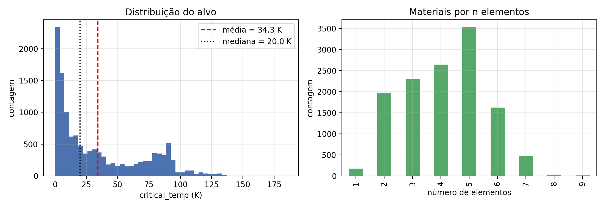
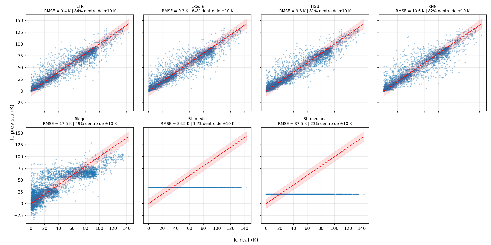

<div id="topo"></div>

<p align="center">
  
</p>

<h1 align="center">Tiamat</h1>

<p align="center">
  Entrega final da disciplina <strong>Aprendizado de máquina</strong> — ATP-T26.2
</p>

<hr>

## Sumário

* [Apresentação do projeto](#apresentação-do-projeto)
* [Estrutura](#estrutura)
* [O dataset](#o-dataset)
* [Algoritmos](#algoritmos)
* [Otimização](#otimização)
* [Seleção dos modelos](#seleção-dos-modelos)
* [Resultados](#resultados)
* [Finalização](#finalização)
* [Uso de I.A.](#uso-de-ia)
* [Licenças](#licenças)


<hr>

## Apresentação do projeto

Este projeto foi desenvolvido como entrega final da disciplina de
**Aprendizado de máquina**, ministrada pelo **prof. Dr. Daniel Roberto Cassar**, para a turma de 2026 da **Ilum Escola de Ciência** e foi desenvolvido pelo discente **Álex Vinícius Reis de Araujo**.

O objetivo consiste em comparar 5 algoritmos/pipelines diferentes para prever as temperaturas críticas de diferentes supercondutores. Os algoritmos serão especificados na seção dos algoritmos, enquanto o dataset será explorado em sua respectiva seção. Apresentações feitas, vamos falar sobre a estrutura do projeto.

## Estrutura

O projeto está organizado em diferentes diretórios, para evitar repetições de arquivos com funções análogas, usarei "ALG" para referenciar os algoritmos, cada diretório com esta sigla terá sua respectiva versão para cada algoritmo.

<pre><code>Alex-Ilum-T26/Tiamat/
|
|--> data
| |-> train.csv
| |-> unique_m.csv
|
|--> figuras
| |-> Gráficos de frequência de hiperparâmetros
| |-> logo-Ilum.png
|
|--> otimizacao (arquivos usados no HPC para HP tuning)
| |--> data_TTV
| | |-> df_teste.csv
| | |-> df_treino.csv
| | |-> df_val.csv
| |
| |--> E_ALG
| | |-> logs
| | |-> studies
| |
| |-> otimizacao.py
| |-> OTM_ALG.py
| |-> OTM_etr.sh
| |-> OTM_paralelo.sh
| |-> OTM_exodia.sh
| |-> OTM_singular.sh
| |-> analise.ipynb (gera imagens)
| |-> candidados.csv
|
|--> .gitignore
|--> LICENSE
|--> README.md
|__ analise.ipynb</code></pre>

Nota: Os arquivos foram reorganizados para melhorar a legibilidade, se quiser rodar os processos da etapa de otimização que constam neste repositório, será necessário modificar os caminhos.

O arquivo ``otimizacao.py`` funciona como um módulo que cuida de configurar todos os processos, desde instanciamento de algoritmos, criação dos trials, etc. O foco desta seção é no uso dos algoritmos, usando o arquivo ``OTM_ETR.py`` como exemplo de uso do módulo:

``` python
import pandas as pd
from otimizacao import *
from sklearn.ensemble import ExtraTreesRegressor

df = pd.read_csv("./data_TTV/df_treino.csv")

X_treino = df.drop("critical_temp", axis=1)
y_treino = df[["critical_temp"]].values.ravel()

ensaios = estudo(nome="ETR_ciclo3_corr", arquivo="E_ETR/ETR_ciclo3_corr", carregar=True)

ensaios.optimize(lambda trial: objetivo(trial=trial, X=X_treino, y=y_treino, algoritmo=ExtraTreesRegressor), n_trials=100)
```

Para submeter o processo para otimização de hiperparâmetros no HPC, usarei como exemplo o ``OTM_singular.sh`` configurado para o ``ExtraTreesRegressor``. Lembrando que os caminhos não são os mesmos.

```
#!/bin/bash
#SBATCH --job-name=ETR_3_corr
#SBATCH --partition=cpu
#SBATCH --nodes=1
#SBATCH --ntasks=1
#SBATCH --cpus-per-task=6
#SBATCH --mem=2G
#SBATCH --time=01:00:00
#SBATCH --output=%x-%j.out
#SBATCH --error=%x-%j.err

source "$(conda info --base)/etc/profile.d/conda.sh"
conda activate ilumpy

export OMP_NUM_THREADS=1
export OPENBLAS_NUM_THREADS=1
export MKL_NUM_THREADS=1

BASE=/home/alex2610082/work/Tiamat
mkdir -p "$BASE/E_ETR"
cd "$BASE"

python -u OTM_ETR.py > "$BASE/E_ETR/ETR_final_2.log" 2>&1
```

## O dataset

Este projeto usa o **Superconductivity Data Set** (Hamidieh, 2018), disponível no
[UCI Machine Learning Repository](https://archive.ics.uci.edu/), sob licença [Creative Commons Attribution 4.0 International](https://creativecommons.org/licenses/by/4.0/legalcode). 

O objetivo é prever a **temperatura crítica** (``critical_temp``, em Kelvin) de um supercondutor, a partir de características derivadas da sua composição química, sendo um problema de **regressão**. Para reduzir o escopo do projeto, foi usado apenas o DataSet ``train.csv``, que possui as características dos materiais, sem analisar diretamente a composição química.

### Visão geral

| Item | Descrição |
|---|---|
| Amostras ( dataset de treino) | 12.757 |
| Features | 81 (apenas numéricas) |
| Alvo | ``critical_temp`` (K) |
| Valores ausentes | nenhum |
| Divisão dos dados | treino / teste / validação: 60 / 20 / 20, com ``random_state=12151822`` |

### Variáveis

Como dito anteriormente, cada exemplo é um material e seus atributos são propriedades calculadas a partir da composição química:

* ``number_of_elements``: número de elementos distintos no material.
* 8 propriedades, cada uma resumida por 10 estatísticas, totalizando 80 colunas:

| Propriedade | Unidade |
|---|---|
| `atomic_mass` (massa atômica) | AMU |
| `fie` (primeira energia de ionização) | kJ/mol |
| `atomic_radius` (raio atômico) | pm |
| `Density` (densidade) | kg/m³ |
| `ElectronAffinity` (afinidade eletrônica) | kJ/mol |
| `FusionHeat` (calor de fusão) | kJ/mol |
| `ThermalConductivity` (condutividade térmica) | W/(m·K) |
| `Valence` (valência) | — |

Estatísticas aplicadas a cada propriedade (prefixo `wtd_` = ponderada pela fração de cada elemento no material): `mean`, `wtd_mean`, `gmean`, `wtd_gmean`, `entropy`,
`wtd_entropy`, `range`, `wtd_range`, `std`, `wtd_std`.
Exemplo: `wtd_mean_Density` é a densidade média ponderada pela composição.

### Alvo

`critical_temp` varia de 0 a 185 K (média ≈ 34,3 K; mediana = 20 K) e tem distribuição assimétrica à direita: a maioria dos materiais tem temperatura crítica baixa, com uma cauda de valores altos.




 **Consideração**:

A busca de hiperparâmetros usa apenas o conjunto de treino associado à validação cruzada de 5 folds, enquanto os conjuntos de validação e teste apenas são usados após a escolha dos modelos.

<hr>

## Algoritmos

Foram comparados 5 algoritmos/pipelines de regressão, todos implementados com o módulo ``scikit-learn``. Para os algoritmos sensíveis à escala dos dados, o KNN e o Ridge, os dados foram tratados pelo ``RobustScaler``, e todos usam ``SelectPercentile`` com  ``f_regression`` como seleção de variáveis.

| Algoritmo | O que faz | Motivo da escolha |
|---|---|---|
| Ridge | Regressão linear com regularização L2. | Sua simplificade e velocidade, principalmente para estimador final do stacking. |
| KNN | Média das temperaturas dos k vizinhos mais próximos, ponderada pela distância. | Captura relações localmente. |
| HistGradientBoosting (HGB) | Árvores em sequência, cada uma corrigindo o erro da anterior. | É um método robusto e escala bem com a quantidade de dados. |
| ExtraTrees (ETR) | Floresta de árvores com limiares de divisão sorteados. | Consegue paralelizar bem e possui baixa variância graças à sua aleatoriedade. |
| Stacking ("Exodia") | KNN + HGB + ETR combinados por um meta-modelo com Ridge de estimador final, treinado nas previsões fora da amostra. | Por usar modelos muito diferentes, tende a generalizar melhor. |

Para baseline, foi usado o ``DummyRegressor``, também do ``scikit-learn``, que sempre prevê a média dos dados, tendo RMSE $\approx$ 34K, sendo aproximadamente o desvio padrão dos dados de teste.

### Um pouco mais sobre o stacking

Diferentemente dos algoritmos individuais, não foi usada redução de dimensionalidade para o stacking, pois os algoritmos de base demonstraram desempenho melhor mantendo as dimensões. Adicionalmente, o meta-modelo usa validação cruzada aninhada, com validação cruzada interna de 3 folds e um 5-Fold externo.

## Otimização

Os hiperparâmetros foram buscados com o módulo ``Optuna``, usando seu amostrador padrão (TPE), apenas no conjunto de treino.

* **Métrica:** RMSE em validação cruzada de 5 folds embaralhados e a semente-padrão do autor: ``random_state=12151822``

* **Pontuação do trial:** computa o pior valor dentre a média e a mediana dos 5 folds, de modo a penalizar trials com folds favoráveis.

* **Número de trials:** todos os algoritmos foram otimizados com, pelo menos, um ciclo de 100 trials. Alguns estudos que possuem números de trials diferentes são decorrentes de testes de viabilidade, para poucos trials, ou testes reforço extra em casos de pouco desempenho.

* **Ciclos de refinamento:** Cada algoritmo individual foi sujeitado a, no mínimo, 3 ciclos de refinamento da busca de hiperparâmetros. O critério utilizado foi a faixa de atributos mais frequentes dos 25% melhores estimadores de cada ciclo, com o ciclo subsequente tendo seu espaço de busca ajustado para a faixa encontrada.

* **Armazenamento:** cada estudo é salvo em diretórios seguindo o padrão ``E_ALG/studies``, permitindo acessar estudos passados.

### Execução no HPC

A otimização foi executada no Heisenberg, HPC da Ilum, via Slurm. Para os algoritmos menos custosos (HGB, KNN e Ridge), foi usado paralelismo para treiná-los concomitantemente com 1 CPU para cada, enquanto os mais custosos (ETR e Stacking) precisaram de jobs individuais com maior uso de CPUs, usando de 6 a 8 para cada.

## Seleção dos modelos

1. Para cada algoritmo, os 5 melhores trials por validação cruzada foram ajustados no treino completo.

2. Esses candidatos foram comparados no **conjunto de validação**, ``df_val.csv``, que não participou da busca.

3. O candidato com menor RMSE na validação foi escolhido para cada algoritmo, e o desempenho final foi medido apenas uma vez no conjunto de teste.

Todas estas etapas servem para evitar resultados otimistas, garantindo que os algoritmos generalizem bem para dados novos.

## Resultados

Este é um plot com as medidas finais dos modelos. Percebe-se que o Ridge teve o pior desempenho dentre os algoritmos usados, com apenas 49% das previsões dentro da margem de 10 K. Além disso, apesar do Exodia e do ETR terem erros comparáveis entre si, o custo computacional do primeiro é muito maior que o último, sendo cerca de três vezes mais lento. O erro comparável provavelmente decorre do uso do Ridge, um algoritmo linear, como estimador final, enquanto o custo computacional decorre do uso dos demais 4 algoritmos juntos.



A análise detalhada, com discussão dos resultados, está no notebook [`main.ipynb`](main.ipynb).

## Finalização

Falar sobre a melhor abordagem para o problema e qual o erro dela.

### Limitações

* **Divisão aleatória.** Materiais da mesma família química têm composições parecidas e podem cair em conjuntos diferentes, o que torna as métricas mais otimistas para materiais realmente novos. Futuramente, será usado KFold estratificado por grupos para contornar este problema.

* **Composição não usada.** O `unique_m.csv` não entrou nos modelos, e as variáveis descrevem a composição de forma agregada. Numa possível aplicação futura, a composição também será levada em conta.


## Uso de I.A.

Foi usado o **Claude** (Anthropic) como apoio nas seguintes etapas: revisão da configuração dos jobs no Slurm (alocar CPUs, memória e configurar o paralelismo), revisão de erros nos códigos, sugestões de espaços de busca iniciais, ajuda na estruturação deste README, ajuda com bugs no código.

As decisões de modelagem, a execução dos experimentos, a análise dos resultados e a redação final são de responsabilidade do autor. Todos os números e métricas foram computados pelo código, nenhum foi feito artificialmente ou gerado por I.A.

## Licenças

Os códigos presentes neste projeto estão licenciados sob a licença GNU [General Public License v3.0](https://www.gnu.org/licenses/gpl-3.0.html), enquanto o dataset mantém sua licença original [C.C by 4.0](https://creativecommons.org/licenses/by/4.0/legalcode).


<p align="right">
  <a href="#topo">Voltar ao topo</a>
</p>